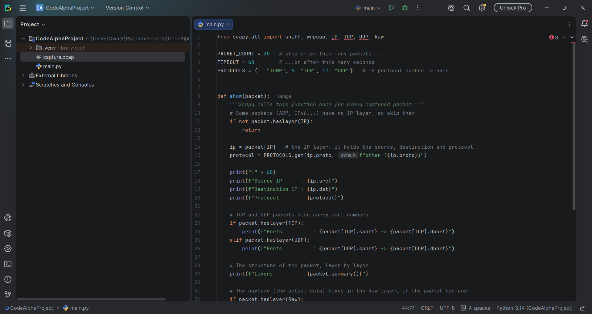
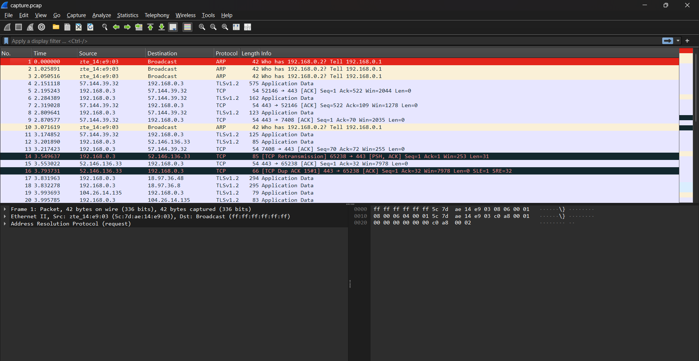
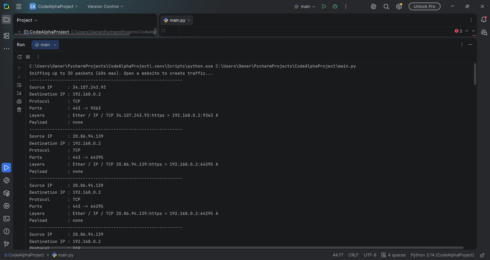

# Basic Network Sniffer in Python (Scapy)

**CodeAlpha Cyber Security Internship, Task 1.**

A basic network sniffer. It captures live traffic and shows what is inside each packet: who sent it, who receives it, which protocol and ports it uses, and a preview of the data. The capture is also saved to `capture.pcap`, which opens in Wireshark.

```text
network card -> Npcap (capture driver) -> Scapy sniff() -> show() runs for every packet -> capture.pcap
```

## Requirements

- Python 3
- Scapy: `pip install scapy`
- Npcap on Windows (it is installed together with Wireshark, or download it from <https://npcap.com>)

## Run

```text
python network_sniffer.py
```

Open a website while it runs to create traffic. It stops after 30 packets or 60 seconds, whichever comes first, then saves `capture.pcap`. Press Ctrl+C to stop earlier. If you get a permission error, run the terminal (or PyCharm) as Administrator.

## Example output

The addresses will be different on your computer.

```text
Sniffing up to 30 packets (60s max). Open a website to create traffic...
------------------------------------------------------------
Source IP      : 192.168.0.2
Destination IP : 20.86.94.139
Protocol       : TCP
Ports          : 64295 -> 443
Layers         : Ether / IP / TCP 192.168.0.2:64295 > 20.86.94.139:https PA / Raw
Payload        : 31 bytes, starts with b'\x17\x03\x03\x00\x1az\x9az\xb6\xb3O\xac\xab\xd4\xadU\x12\xceZKV.Y\x10a\xb5\x860\x9d\xf7\xf9'
------------------------------------------------------------
Source IP      : 192.168.0.2
Destination IP : 192.168.0.3
Protocol       : UDP
Ports          : 53812 -> 44002
Layers         : Ether / IP / UDP 192.168.0.2:53812 > 192.168.0.3:44002 / Raw
Payload        : 38 bytes, starts with b'\x80e\x01\xb2\x00\x00\x00\x00\x00\x00\x00\x00@\xdf\xd4\x85a>\xb9\xe5\xd0\x0c\x07\xec^\x87q\xd6\xf8\xc1"WK@\x91YsU'

Done. Captured 30 packets, saved to capture.pcap
```

## What each line means

| Line | Meaning |
|---|---|
| Source IP | Address of the sender |
| Destination IP | Address of the receiver |
| Protocol | TCP (reliable connections: web, email), UDP (fast, no handshake: DNS, video calls) or ICMP (ping and network errors) |
| Ports | Sender port -> receiver port. The destination port shows the service: 80 is HTTP, 443 is HTTPS, 53 is DNS |
| Layers | The protocol layers inside the packet, from the outside in |
| Payload | The data the packet carries. HTTPS data is encrypted, so it looks like random bytes. |

## How the code works

1. `sniff(prn=show, count=30, timeout=60)` listens on the network card and calls `show()` for every packet.
2. `show()` skips packets without an IP layer (ARP, IPv6), reads the source, destination and protocol from the IP layer, and the ports from the TCP or UDP layer.
3. `packet.summary()` prints the layers. The `Raw` layer, if present, holds the payload.
4. `wrpcap()` saves all captured packets to `capture.pcap`.


## Open the capture in Wireshark

Start Wireshark, choose **File > Open** and select `capture.pcap`. You can then filter and inspect the same packets in more detail.


## Notes

- Packets without an IP layer are saved in `capture.pcap` but not printed, so fewer than 30 may appear on screen.
- Capture traffic only on networks you own or have permission to monitor.
- `capture.pcap` can contain private data (websites visited, cookies on unencrypted pages), so do not share it.

## Files

| File | Purpose | Evidence |
|---|---|---|
| `network_sniffer.py` | The sniffer |   |
| `capture.pcap` | Created when you run it (not stored in this repository) |  |

# 👤 Author

**ADEBAYO IBRAHIM**\
Cybersecurity Professional

LinkedIn: [www.linkedin.com/in/ibrahim-adebayo-118613449](www.linkedin.com/in/ibrahim-adebayo-118613449/)

---

## 📌 Project Information

**Program Name:** Cybersecurity at CodeAlpha | **Task 01** Basic Network Sniffer| **Repository:** GitHub
